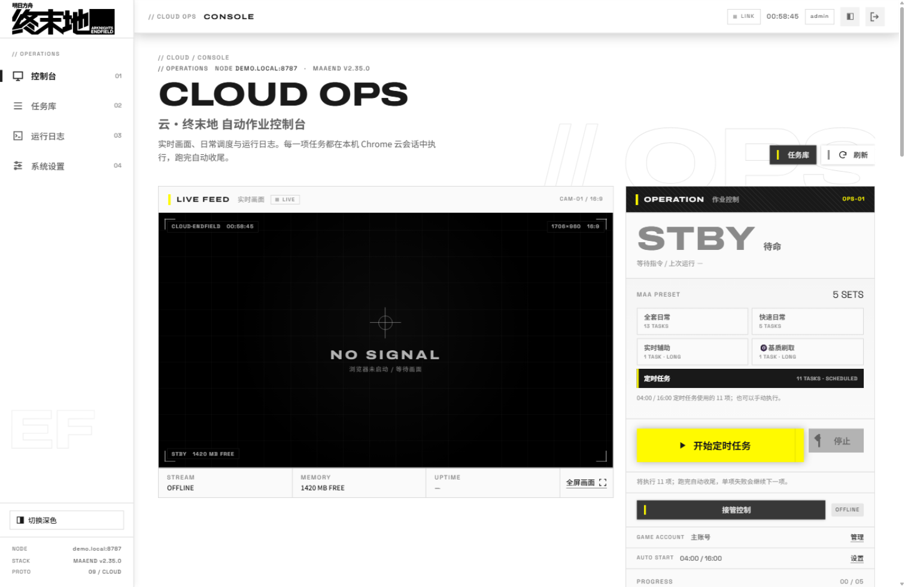
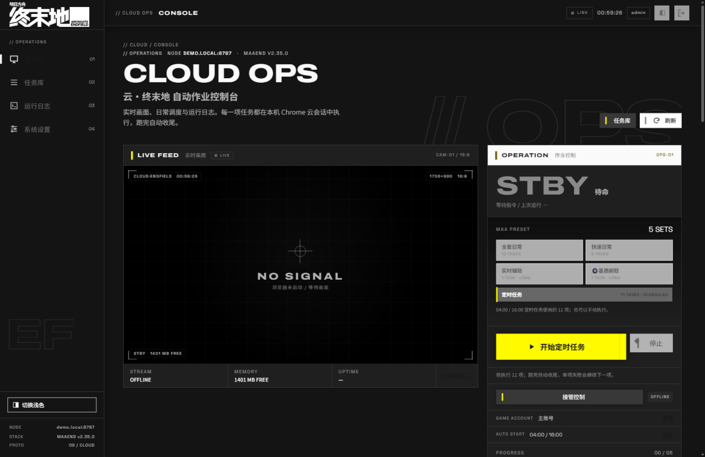
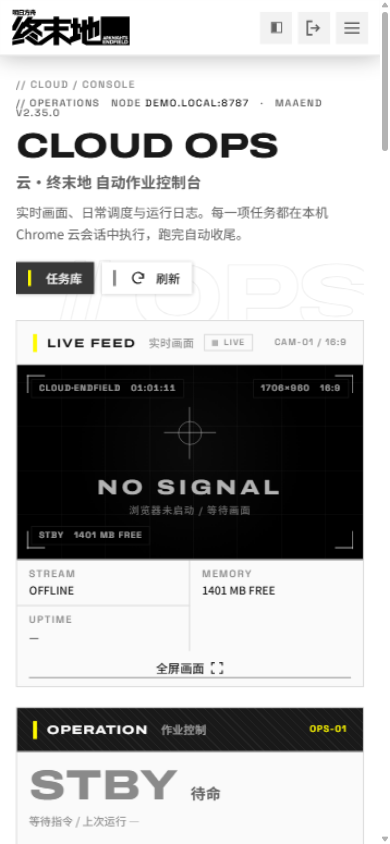
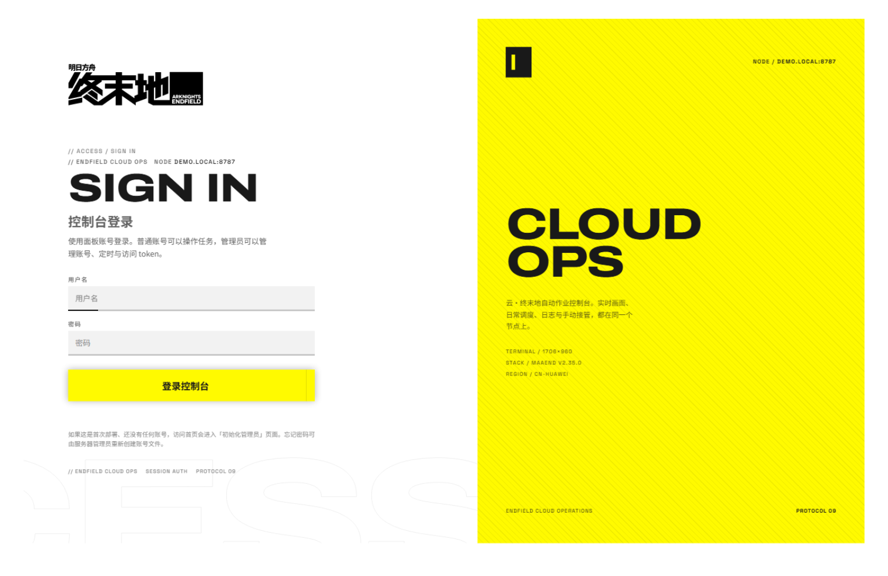

# Endfield Cloud Ops

> 基于 **MaaEnd** 的《明日方舟：终末地》云游戏网页控制台。  
> A web console for MaaEnd automation on the Endfield cloud client.



## 这是什么

`Endfield Cloud Ops` 是一个自托管的网页面板，用来在 Linux 服务器上远程操作 MaaEnd：启动云游戏、跑日常、选任务、改任务选项、看实时画面、接管 VNC、安排定时，以及从面板更新 MaaEnd。

它不重新实现自动化逻辑，而是把 **MaaEnd / MaaFramework** 已有的任务和 pipeline 接到一个更适合服务器和手机使用的 Web UI 上。

> **本项目基于 [MaaEnd](https://github.com/MaaEnd/MaaEnd)（AGPL-3.0）**。  
> MaaEnd 是「明日方舟：终末地」的视觉 AI 自动化工具；本仓库只提供网页控制台、服务器运行脚本和部署层。  
> 本项目不是 MaaEnd 官方项目，与 MaaEnd 作者无隶属关系。

## 功能

- **实时画面**：Chrome CDP `Page.startScreencast` 推流，支持 2 秒 1 张、1 秒 1 张、1 秒 3 张、1 秒 5 张；只影响面板预览，不改变 Maa 的识别通道。
- **云游戏时长识别**：对实时画面右侧时长卡片做 Tesseract 中文 OCR，显示剩余免费 / 付费时长，每 30 秒刷新；识别失败时显示 `--`，不影响任务运行。
- **Maa 内置预设**：直接读取 MaaEnd `tasks/preset/*.json`，提供全套日常、快速日常、实时辅助、基质刷取，以及面板定时任务。
- **历史运行**：每次运行自动记录排队/启动时长、任务结果、成功数和总耗时；在「历史运行」页可以展开查看逐项任务。
- **任务库 / 待选队列**：从 MaaEnd 最新 `interface.json` 生成任务目录；带 MXU `optionValues` 设置编辑（switch / select / checkbox / input，含嵌套子选项）。
- **定时运行**：面板里维护 `HH:MM` 时间点，写入 `maa` 用户 crontab；默认 04:00 / 16:00。
- **Maa 更新**：检查 GitHub Release → 下载 → 备份 → 替换 → `post_upgrade_check.py` 自检 → `option_audit.py` 覆盖项检查；失败自动回滚。
- **接管控制**：启动 Chrome + Wayland + wayvnc + noVNC，并通过面板端口反向代理 `/vnc/*`，不需要额外放行 6080。
- **账号与安全**：PBKDF2 管理员/普通账号、HttpOnly 会话、可选 token、登录限速；所有 `/api/*` 默认需要认证。
- **界面**：Endfield 风格浅色/深色主题、桌面侧栏、移动端菜单、无第三方前端框架。

## 架构

```text
Browser / Phone
      │  HTTP :8787
      ▼
  webui.py  ────────────────► CDP 127.0.0.1:9334 ──► Chrome (Wayland/SwiftShader)
      │                              │
      │                              └── 实时画面 / 页面控制
      ├── /vnc/* ──► websockify ──► wayvnc 127.0.0.1:6080
      │
      └── daily_run_homesrv.sh
              │
              ▼
       run_daily_linux.py ──► MaaEnd / MaaFramework
              │
              ├── resolve_preset.py  (MXU optionValues → pipeline_override)
              ├── web/resource_web   (网页端 pipeline / 图像覆盖层)
              └── mxu-MaaEnd.json    (实例、任务、选项)
```

## 截图

| 浅色 | 深色 |
| --- | --- |
|  |  |

| 移动端 | 登录 |
| --- | --- |
|  |  |

## 快速开始

完整步骤见 [docs/DEPLOY.md](docs/DEPLOY.md)。

```bash
# 1. 以 maa 用户安装 MaaEnd / Python venv / Chrome / sway
#    MaaEnd 默认路径：/home/maa/maaend

# 2. 克隆本项目
git clone <YOUR_REPO_URL> /home/maa/endfield-cloud-ops
cd /home/maa/endfield-cloud-ops

# 3. 安装面板与运行脚本
sudo -u maa bash deploy/install.sh

# 4. 生成任务目录
sudo -u maa env MAAEND_ROOT=/home/maa/maaend \
  HOME=/home/maa /home/maa/venv/bin/python \
  /home/maa/maaend-webui/gen_catalog.py

# 5. 启动服务
sudo systemctl daemon-reload
sudo systemctl enable --now maaend-webui

# 6. 打开 http://<SERVER_IP>:8787/setup 初始化管理员
```

> 项目**不提供默认账号或默认密码**；请在 `/setup` 页面自行创建管理员账号（密码至少 8 位）。

## 目录结构

```text
.
├── panel/                  # 复制到 /home/maa/maaend-webui
│   ├── webui.py            # Python 标准库 HTTP 服务 + 认证 + VNC/CDP 代理
│   ├── gen_catalog.py      # 从 MaaEnd interface.json 生成 tasks.json
│   ├── static/             # 前端（无构建步骤）
│   └── web/                # 复制到 /home/maa/maaend-web/web
│       ├── linux/          # runner、CDP、Wayland 工具
│       └── resource_web*/  # 网页端 pipeline / 图像覆盖层
├── deploy/
│   ├── install.sh          # 安装到 /home/maa（谨慎：会覆盖同名文件）
│   ├── maaend-webui.service
│   ├── fetch-novnc.sh
│   └── mxu-MaaEnd.example.json
├── docs/
│   ├── DEPLOY.md
│   ├── TEST-REPORT.md
│   └── assets/
├── LICENSE                 # AGPL-3.0
└── NOTICE.md
```

## 已验证

测试记录见 [docs/TEST-REPORT.md](docs/TEST-REPORT.md)。当前线上验证环境：

- Ubuntu 24.04 / MaaEnd **v2.35.0**
- 任务库 **49 项**，其中 **39 项**带可调选项
- Maa 预设 dry-run：全套日常 13 项、快速日常 5 项、实时辅助 1 项、基质刷取 1 项
- 面板启动/停止、预设切换、定时、Maa 更新、VNC 代理、桌面/移动端布局均已验证
- 云游戏排队可能长达约 40 分钟；`WebStartGame` 上限 2 小时，普通任务默认 420 秒

## Docker

提供两个镜像：

| 标签 | 内容 | 用途 |
| --- | --- | --- |
| `xl233/endfield-cloud-ops:latest` | 面板 + Chrome + sway + noVNC | 需要挂载现有 MaaEnd/venv |
| `xl233/endfield-cloud-ops:full` | 面板 + **MaaEnd v2.35.0** + MaaFw venv + Chrome + sway + noVNC | 一体化，无需挂载 MaaEnd |

### 一体化镜像（推荐）

```bash
docker run -d --name endfield-cloud-ops \
  --restart unless-stopped \
  -p 8787:8787 \
  --shm-size=1g \
  -v endfield-config:/home/maa/.config \
  -v endfield-data:/home/maa/data \
  xl233/endfield-cloud-ops:full
```

镜像内已经包含 MaaEnd 和 Python venv，启动后直接打开 `/setup` 创建管理员即可。  
项目**不提供默认账号或默认密码**。

如需让 MaaEnd 更新在容器重建后保留，可额外挂载
`-v endfield-maaend:/home/maa/maaend -v endfield-venv:/home/maa/venv`
（首次会从镜像内容初始化）。

### 面板运行时镜像

适合已经有一套 MaaEnd 的机器，只替换前端/控制层：

```bash
docker run -d --name endfield-cloud-ops \
  --restart unless-stopped \
  -p 8787:8787 \
  --shm-size=1g \
  -v /home/maa/maaend:/home/maa/maaend \
  -v /home/maa/venv:/home/maa/venv \
  -v endfield-config:/home/maa/.config \
  -v endfield-data:/home/maa/data \
  xl233/endfield-cloud-ops:latest
```

详细说明见 [docker/README.md](docker/README.md)。

## 安全提示

- 首次部署后立即设置强密码；不要继续使用示例/临时密码。
- 面板拥有启动/停止云游戏和接管画面的权限，建议只绑定内网或通过 Nginx/Caddy 加 HTTPS + IP allowlist。
- 不要公网暴露 wayvnc/websockify 的 6080；VNC 已通过 `/vnc/*` 反代。
- 不要把 `users.json`、`game-accounts.json`、`active-profile`、`auth.conf`、`token` 提交到仓库；`.gitignore` 已排除。
- 面板会执行 `sudo` 以外的用户级脚本；请只在受信任的服务器上运行。

## 基于 MaaEnd / 许可证

- 本项目基于 **[MaaEnd](https://github.com/MaaEnd/MaaEnd)**，MaaEnd 使用 **AGPL-3.0**。
- `panel/web/linux/` 下的部分 runner、preset 解析和更新脚本改编自 MaaEnd / MaaEnd Web overlay，按 **AGPL-3.0** 分发。
- 本仓库整体使用 **AGPL-3.0**，完整文本见 [LICENSE](LICENSE)。
- MaaEnd / MaaFramework / MXU 的名称与版权归各自作者所有。
- 《明日方舟：终末地》名称、Logo 与游戏素材版权归 Hypergryph 所有；本仓库仅用于个人自托管的自动化辅助，非官方、非商业项目。

第三方依赖与素材说明见 [NOTICE.md](NOTICE.md)。

## 贡献

欢迎提 issue / PR。提交前请确认：

1. 不包含服务器 IP、账号、密码、token、Cookie 或截图中的个人信息。
2. 不把运行时文件（`users.json`、`game-accounts.json`、`tasks.json`、`progress.json` 等）加入提交。
3. 修改 MaaEnd 派生脚本时保留 AGPL-3.0 许可和来源说明。
